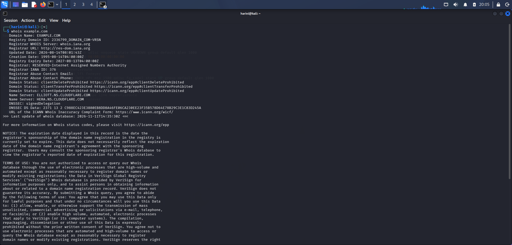
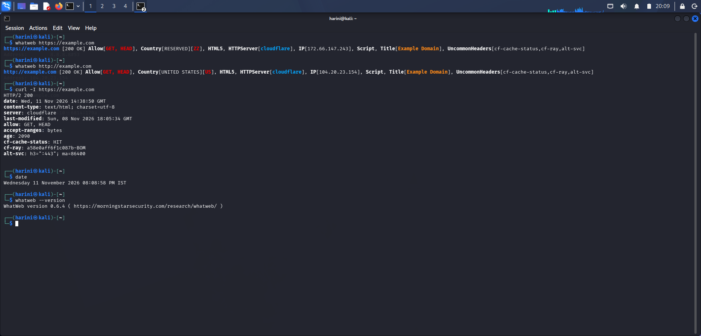
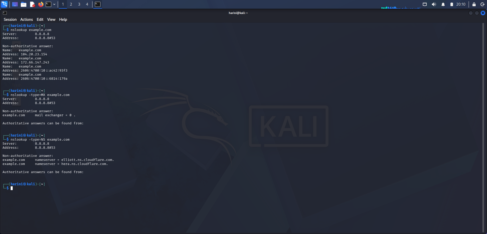
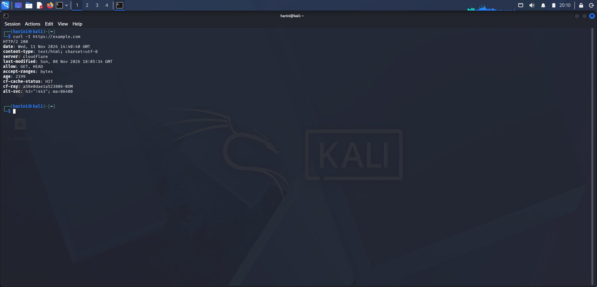
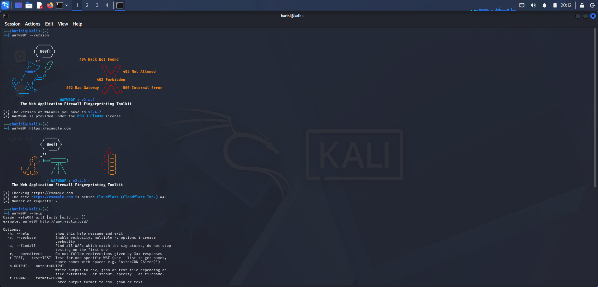
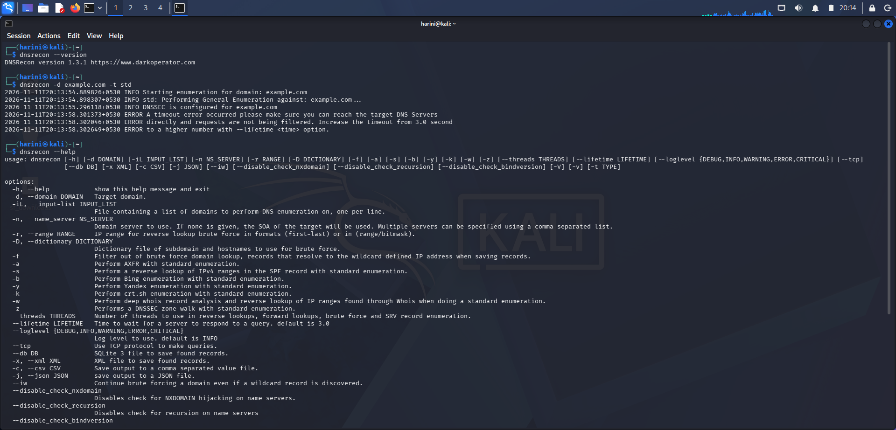

# 🔎 PM1 – Footprinting and Information Gathering

**Reconnaissance • DNS Enumeration • Web Technology Identification • WAF Detection**

## 🔹 Overview

This project focuses on practical footprinting and information-gathering techniques using various cybersecurity tools available in Kali Linux.

The exercises explore how domain registration information, DNS records, website technologies, HTTP response headers, and Web Application Firewall technologies can be identified through different reconnaissance tools.

Six tools were explored to understand the fundamentals of information gathering and website security assessment.

---

## 🔹 Objectives

- Understand the fundamentals of footprinting and reconnaissance.
- Gather domain registration and DNS information.
- Identify website technologies and server details.
- Examine HTTP response headers.
- Understand Web Application Firewall detection.
- Explore DNS enumeration techniques using Kali Linux tools.

---

## 🔹 Tools and Technologies

| Tool | Purpose |
|---|---|
| WHOIS | Domain registration information |
| WhatWeb | Website technology identification |
| Nslookup | DNS record lookup |
| cURL | HTTP response header inspection |
| Wafw00f | Web Application Firewall detection |
| DNSRecon | DNS enumeration |

**Environment:** Kali Linux

---

## 🔹 Practical Exercises

### 01. WHOIS – Domain Information Gathering

**Objective:** Retrieve domain registration information.

**Command:**
```bash
whois example.com
```

**Key Activities:**
- Examined registrar information.
- Identified domain creation and expiration details.
- Observed name servers and domain status.

**Screenshot:**



---

### 02. WhatWeb – Website Technology Identification

**Objective:** Identify technologies and web server information used by a website.

**Command:**
```bash
whatweb http://example.com
```

**Key Activities:**
- Identified website technologies.
- Examined HTTP server information.
- Explored technology fingerprinting.

**Screenshot:**



---

### 03. Nslookup – DNS Information Gathering

**Objective:** Retrieve DNS information associated with a domain.

**Commands:**
```bash
nslookup example.com
nslookup -type=MX example.com
nslookup -type=NS example.com
```

**Key Activities:**
- Retrieved domain IP address information.
- Examined MX records associated with mail servers.
- Identified authoritative name server records.

**Screenshot:**



---

### 04. cURL – HTTP Header Inspection

**Objective:** Examine HTTP response headers and server responses.

**Command:**
```bash
curl -I https://example.com
```

**Key Activities:**
- Sent an HTTP HEAD request.
- Examined HTTP response status.
- Observed response headers and server information.

**Screenshot:**



---

### 05. Wafw00f – Web Application Firewall Detection

**Objective:** Identify the Web Application Firewall protecting a website.

**Command:**
```bash
wafw00f https://example.com
```

**Key Activities:**
- Verified Wafw00f installation.
- Performed WAF identification.
- Identified Cloudflare as the detected WAF provider.

**Tool Version:** 2.4.2

**Screenshot:**



---

### 06. DNSRecon – DNS Enumeration

**Objective:** Explore DNS enumeration and identify DNS records.

**Command:**
```bash
dnsrecon -d example.com -t std
```

**Key Activities:**
- Verified DNSRecon installation.
- Performed standard DNS enumeration.
- Examined DNS-related information returned by the tool.

**Tool Version:** 1.3.1

**Screenshot:**



---

## 🔹 Key Learning Outcomes

- Understanding domain footprinting and reconnaissance.
- Exploring DNS records and domain name resolution.
- Identifying web technologies and server information.
- Understanding HTTP request and response headers.
- Learning the role of Web Application Firewalls.
- Exploring DNS enumeration using specialized tools.
- Developing practical experience with Kali Linux cybersecurity utilities.

---

## 🔹 Cybersecurity Relevance

Footprinting is an important initial phase of authorized security assessments. It helps security professionals understand the information exposed by domains and web applications.

The knowledge gained through these exercises provides a foundation for reconnaissance, attack-surface understanding, and security assessment activities.

---

## 🔹 Official Resources

- [WHOIS – ICANN](https://www.icann.org/resources/pages/whois-2018-01-17-en)
- [WhatWeb – GitHub](https://github.com/urbanadventurer/WhatWeb)
- [cURL Documentation](https://curl.se/docs/)
- [Wafw00f – GitHub](https://github.com/EnableSecurity/wafw00f)
- [DNSRecon – GitHub](https://github.com/darkoperator/dnsrecon)
- [Kali Linux](https://www.kali.org/)

---

## 🔹 Author

**Harini Madasu**

B.Tech Mathematics and Computing

[LinkedIn Profile](https://www.linkedin.com/)

---

*Continuously learning and building practical skills in cybersecurity, reconnaissance, and network security.*
