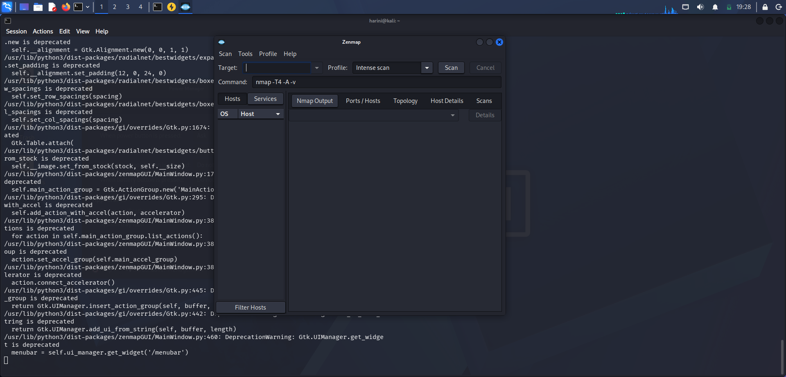
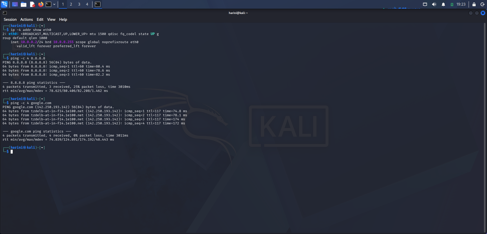
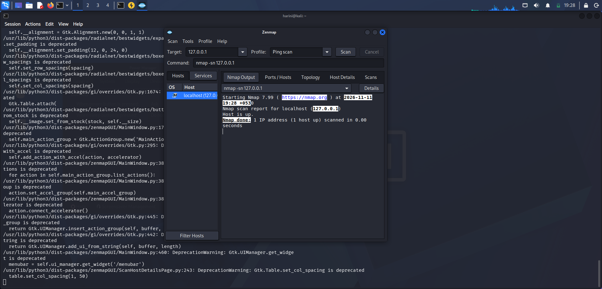
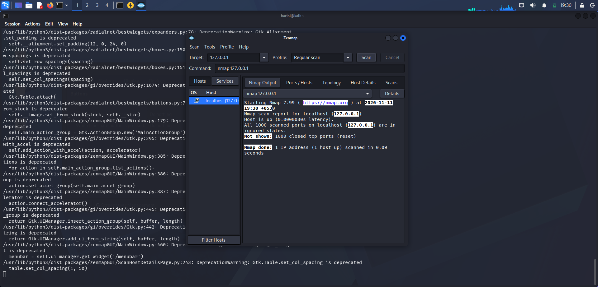
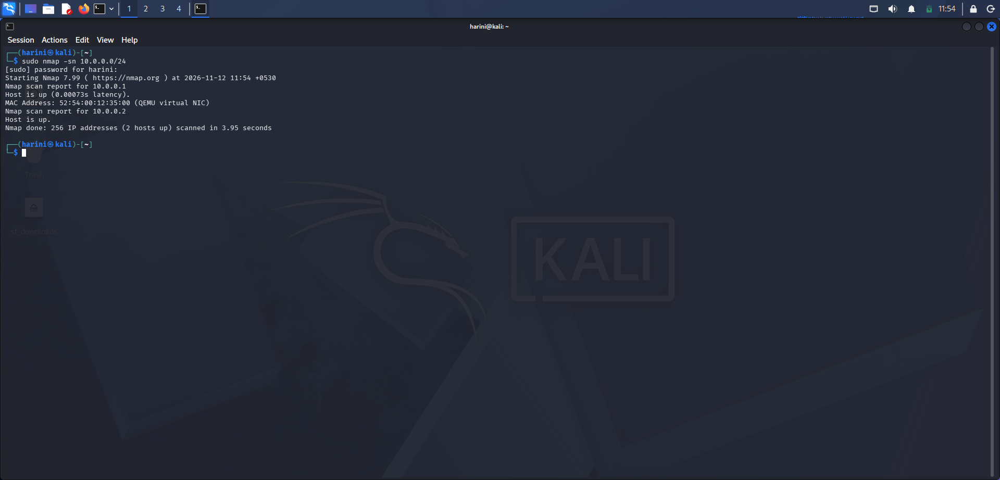
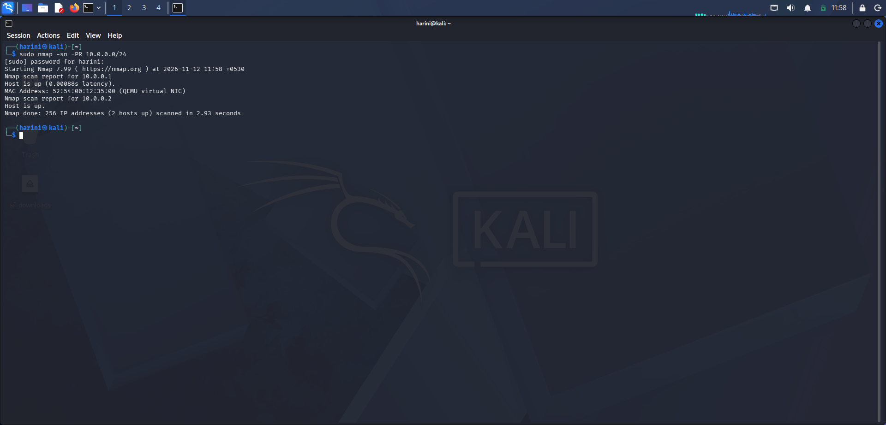
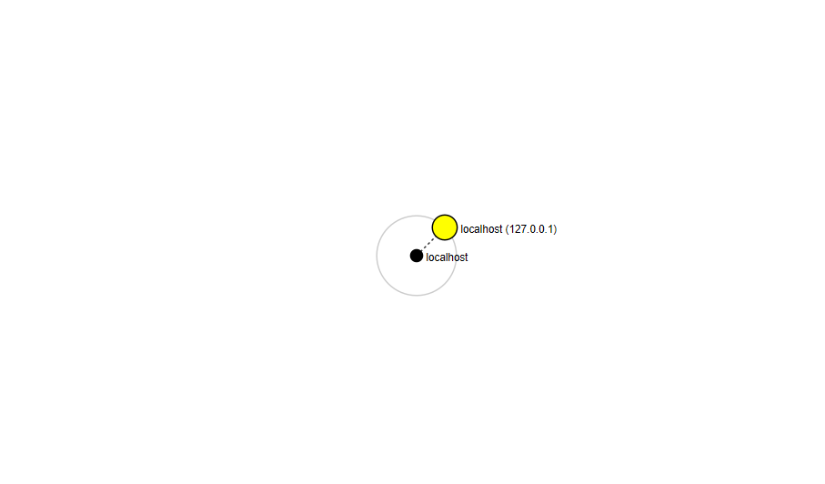

# 🌐 PM5 – Zenmap Network Scanning and Analysis

**Host Discovery • TCP Port Scanning • Service Detection • MAC Address Identification • Network Topology Visualization**

## 🔹 Overview

This project focuses on practical network scanning and analysis using **Nmap and Zenmap** in Windows and Kali Linux environments.

The exercises cover Zenmap interface exploration, host discovery, TCP port scanning, service detection, operating system detection, IP configuration, MAC address identification, and network topology visualization.

The practical work was performed using a Windows system and a Kali Linux virtual machine running in Oracle VirtualBox. For subnet-based host discovery, the Kali Linux VM was connected to an isolated VirtualBox lab network.

## 🔹 Objectives

- Understand network scanning fundamentals.
- Explore the Zenmap graphical interface.
- Identify local IP addresses and subnet configuration.
- Discover live hosts within an authorized lab subnet.
- Count the number of active hosts.
- Identify the IP addresses of discovered hosts.
- Examine MAC addresses using ARP-based discovery.
- Explore TCP port scanning and service detection.
- Understand operating system fingerprinting.
- Generate and save network topology results.

## 🔹 Tools and Technologies

| Tool | Purpose |
|---|---|
| Windows | Initial Zenmap installation and network inspection |
| Kali Linux | Network scanning and host discovery |
| Oracle VirtualBox | Virtualized lab environment |
| Nmap | Network scanning and host discovery |
| Zenmap | Graphical interface for Nmap |
| Terminal / Command Prompt | Executing commands and examining network configuration |

**Lab Network:** `10.0.0.0/24`

**Kali Linux IP Address:** `10.0.0.2`

**Local Host:** `127.0.0.1`

## 🔹 Practical Exercises

### 01. Zenmap Installation and Interface Exploration

**Objective:** Install Zenmap and explore its graphical interface and scanning profiles.

**Key Activities:**

- Installed and launched Zenmap.
- Explored the target field and scan profile selection.
- Examined the scan command and output sections.
- Explored the available scanning profiles.

**Screenshot:**



### 02. Kali Linux IP Configuration

**Objective:** Identify the local IP address and subnet configuration of the Kali Linux virtual machine.

**Commands:**

```bash
ip -br -4 addr
ip route
```

**Key Activities:**

- Examined the available network interfaces.
- Identified the IPv4 address assigned to `eth0`.
- Examined the subnet mask and network route.
- Identified the VirtualBox lab subnet.

**Network Configuration:**

| Parameter | Value |
|---|---|
| Network Interface | eth0 |
| Kali IPv4 Address | 10.0.0.2 |
| Subnet Mask | 255.255.255.0 |
| Network Subnet | 10.0.0.0/24 |

**Screenshot:**



### 03. Ping Scan – Local Host Discovery

**Objective:** Check the availability of the local machine using Nmap.

**Command:**

```bash
nmap -sn 127.0.0.1
```

**Observation:**

Performed a Ping Scan against the loopback address to examine host availability without conducting a port scan.

**Screenshot:**



### 04. Regular Scan – Network Scanning

**Objective:** Explore the Regular Scan profile in Zenmap and examine the scanning output.

**Key Activities:**

- Selected the Regular Scan profile in Zenmap.
- Examined the generated Nmap command.
- Observed the scan output and port information.

**Screenshot:**



### 05. Live Host Discovery – Subnet Scanning

**Objective:** Discover active hosts within the authorized VirtualBox lab subnet.

**Command:**

```bash
sudo nmap -sn 10.0.0.0/24
```

**Explanation:**

- `sudo` – Executes Nmap with elevated privileges.
- `nmap` – Network scanning utility.
- `-sn` – Performs host discovery without port scanning.
- `10.0.0.0/24` – Specifies the VirtualBox lab subnet.

**Observation:**

The scan identified two live hosts within the configured lab subnet.

**Screenshot:**



### 06. Live Host Count and IP Address Identification

**Objective:** Count the discovered live hosts and record their IP addresses.

**Scan Results:**

The Nmap summary reported:

```text
Nmap done: 256 IP addresses (2 hosts up)
```

**Discovered Hosts:**

| Host | IP Address |
|---|---|
| Host 1 | 10.0.0.1 |
| Host 2 | 10.0.0.2 |

**Total Live Hosts:** 2

**Screenshot:**


### 07. MAC Address Identification

**Objective:** Identify the MAC addresses associated with the discovered hosts.

**Command:**

```bash
sudo nmap -sn -PR 10.0.0.0/24
```

**Explanation:**

The `-PR` option performs ARP-based host discovery on the local Ethernet network. Nmap can display MAC address information for discovered hosts.

**Key Activities:**

- Performed ARP-based host discovery.
- Examined the MAC address information in the Nmap output.
- Associated the displayed MAC addresses with their corresponding IP addresses.

**Screenshot:**



### 08. Network Topology Visualization

**Objective:** Visualize the discovered network hosts using Zenmap and save the topology in PDF format.

**Key Activities:**

- Generated an XML scan result using Nmap.
- Opened the XML scan file in Zenmap.
- Examined the discovered hosts in the Hosts tab.
- Explored the Topology tab to visualize the network.
- Captured the topology and saved it as a PDF document.

**XML Generation Command:**

```bash
sudo nmap -sn -oX ~/kali_lab_topology.xml 10.0.0.0/24
```

**Output Files:**

- [kali_lab_topology.xml](kali_lab_topology.xml)
- [Network_Topology.pdf](Network_Topology.pdf)

**Topology Screenshot:**



## 🔹 Scope and Limitations

- Network discovery was performed within the configured VirtualBox lab subnet (`10.0.0.0/24`).
- The scan identified two live hosts: `10.0.0.1` and `10.0.0.2`.
- The MAC address information was examined using ARP-based discovery.
- The college Wi-Fi network was not scanned because authorization to scan other devices was not available.
- Host discovery results represent the configured virtual lab environment and not the entire college network.

## 🔹 Key Learning Outcomes

- Understanding network scanning fundamentals.
- Exploring Nmap and Zenmap.
- Identifying local IP addresses and subnet configurations.
- Performing host discovery using Nmap.
- Counting active hosts and recording their IP addresses.
- Examining MAC addresses through ARP-based discovery.
- Understanding TCP port scanning and scanning profiles.
- Exploring service detection and network analysis.
- Generating XML scan results.
- Visualizing network topology and exporting it as a PDF.

## 🔹 Cybersecurity Relevance

Network scanning is an important activity in network security assessment, network administration, and vulnerability management.

Security professionals use tools such as Nmap and Zenmap to identify active hosts, examine exposed ports, detect running services, and understand network infrastructure.

This practical provided hands-on experience with host discovery, subnet analysis, MAC address identification, and network topology visualization in a controlled virtual lab environment.

## 🔹 Official Resources

- [Nmap Official Website](https://nmap.org/)
- [Nmap Reference Guide](https://nmap.org/book/man.html)
- [Zenmap Documentation](https://nmap.org/zenmap/)
- [Kali Linux Official Website](https://www.kali.org/)
- [Oracle VirtualBox](https://www.virtualbox.org/)

## 🔹 Author

**Harini Madasu**

B.Tech Mathematics and Computing Student

[LinkedIn Profile](YOUR_LINKEDIN_PROFILE_URL)

Continuously learning and building practical skills in cybersecurity, network scanning, and security analysis.
