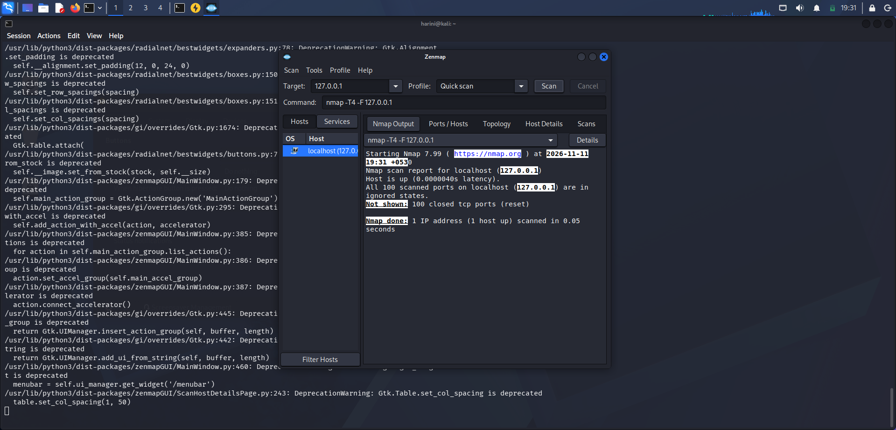
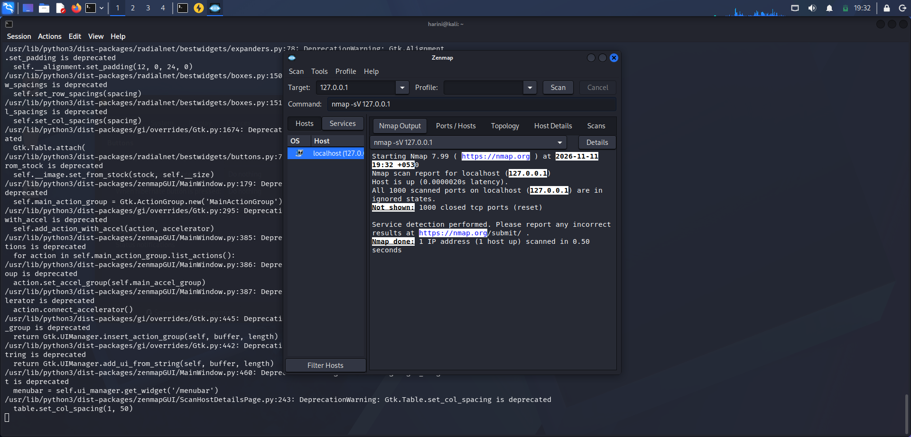
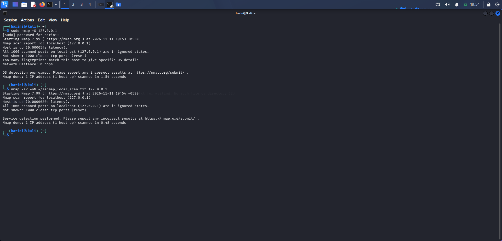
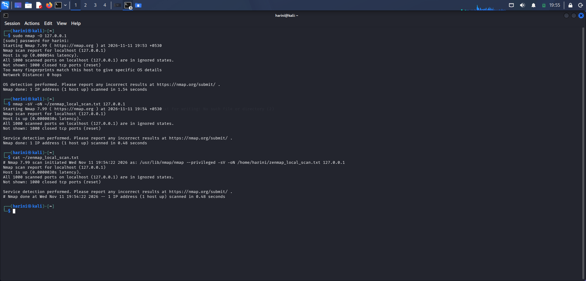

# 🌐 PM5 – Zenmap Network Scanning and Analysis

**Host Discovery • TCP Port Scanning • Service Detection • OS Detection**

## 🔹 Overview

This project focuses on practical network scanning and analysis using Nmap and its graphical interface, Zenmap, in Kali Linux.

The exercises explore host discovery, TCP port scanning, service version detection, and operating system identification.

The scans were performed against the local machine using the loopback address `127.0.0.1` to understand fundamental network scanning techniques in a controlled environment.

---

## 🔹 Objectives

- Understand network scanning fundamentals.
- Explore the Zenmap graphical interface.
- Identify whether a host is reachable.
- Examine TCP port states.
- Understand service version detection.
- Explore operating system fingerprinting.
- Save and analyze Nmap scan results.

---

## 🔹 Tools and Technologies

| Tool | Purpose |
|---|---|
| Kali Linux | Cybersecurity testing environment |
| Nmap 7.99 | Network discovery and scanning |
| Zenmap 7.99 | Graphical interface for Nmap |

**Target:** `127.0.0.1` (Localhost)

---

## 🔹 Practical Exercises

### 01. Zenmap Interface Exploration

**Objective:** Explore the Zenmap graphical interface and available scanning profiles.

**Key Activities:**
- Opened the Zenmap application.
- Explored the target field and profile selection.
- Examined scan command and output sections.
- Identified Ping Scan, Regular Scan, Quick Scan, and Custom Scan profiles.

**Screenshot:**


---

### 02. Ping Scan – Host Discovery

**Objective:** Check whether the local host is active and reachable.

**Command:**
```bash
nmap -sn 127.0.0.1
```

**Observation:**

The scan successfully identified the local host as up.

**Screenshot:**


---

### 03. Regular Scan – TCP Port Scanning

**Objective:** Examine commonly used TCP ports on the local machine.

**Command:**
```bash
nmap 127.0.0.1
```

**Key Activities:**
- Scanned the default 1,000 most common TCP ports.
- Examined port states.
- Observed whether services were listening on the scanned ports.

**Observation:**

The scan reported 1,000 closed TCP ports, indicating that no services were listening on those scanned ports at the time of testing.

**Screenshot:**


---

### 04. Quick Scan

**Objective:** Explore Zenmap's Quick Scan profile and its scanning configuration.

**Key Activities:**
- Examined the Quick Scan profile.
- Observed the Nmap command associated with the profile.
- Reviewed the scan output, if executed.

**Screenshot:**



---

### 05. Custom Scan – Service Version Detection

**Objective:** Identify services and their version information on open ports.

**Command:**
```bash
nmap -sV 127.0.0.1
```

**Key Activities:**
- Used the `-sV` option for service version detection.
- Examined port states and service information.
- Explored how Nmap identifies services running on open ports.

**Screenshot:**



---

### 06. Operating System Detection

**Objective:** Explore operating system fingerprinting using Nmap.

**Command:**
```bash
sudo nmap -O 127.0.0.1
```

**Key Activities:**
- Enabled OS detection using the `-O` option.
- Examined the host status and TCP port information.
- Observed the OS detection output.

**Observation:**

The scan reported 1,000 closed TCP ports. OS identification may be inconclusive on a localhost scan when the available port responses do not provide sufficient fingerprinting information.

**Screenshot:**



---

### 07. Saving Nmap Scan Results

**Objective:** Save scan output for documentation and further analysis.

**Commands:**
```bash
nmap -sV -oN ~/zenmap_local_scan.txt 127.0.0.1
cat ~/zenmap_local_scan.txt
```

**Key Activities:**
- Used the `-oN` option to save scan output in normal text format.
- Stored the output in a text file.
- Displayed the saved scan results using the `cat` command.

**Output File:** `zenmap_local_scan.txt`

**Screenshot:**



---

## 🔹 Key Learning Outcomes

- Understanding network scanning and host discovery.
- Exploring Zenmap's graphical interface and scan profiles.
- Identifying TCP port states.
- Understanding service version detection.
- Exploring operating system fingerprinting.
- Saving and reviewing scan outputs.
- Developing practical experience with Nmap in Kali Linux.

---

## 🔹 Cybersecurity Relevance

Network scanning is an important activity in network security assessment and vulnerability management.

Security professionals use scanning tools to discover active hosts, examine exposed ports, identify services, and understand the network attack surface.

These exercises provided foundational practical experience with Nmap and Zenmap in a controlled local environment.

---

## 🔹 Official Resources

- [Nmap Official Website](https://nmap.org/)
- [Nmap Reference Guide](https://nmap.org/book/man.html)
- [Zenmap Documentation](https://nmap.org/zenmap/)
- [Kali Linux](https://www.kali.org/)

---

## 🔹 Author

**Harini Madasu**

B.Tech Mathematics and Computing Student

[LinkedIn Profile](https://www.linkedin.com/)

---

*Continuously learning and building practical skills in cybersecurity, network scanning, and security analysis.*
