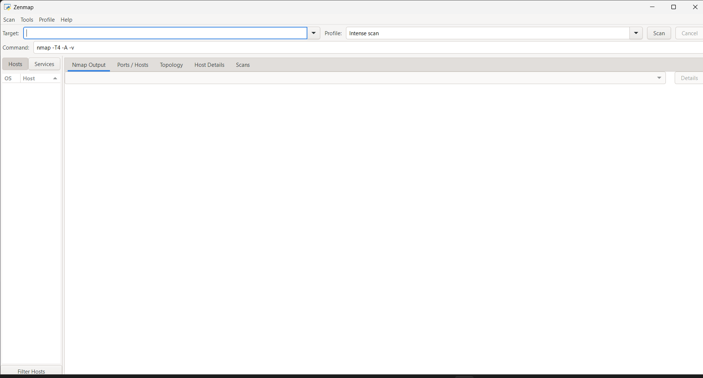
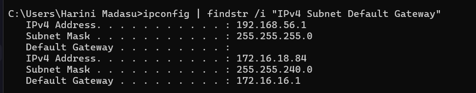
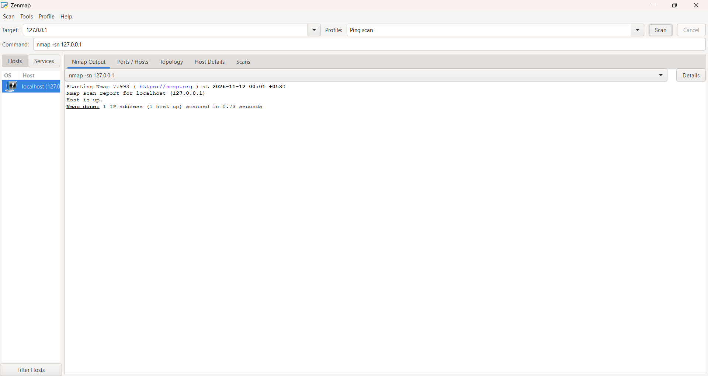
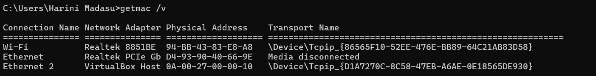
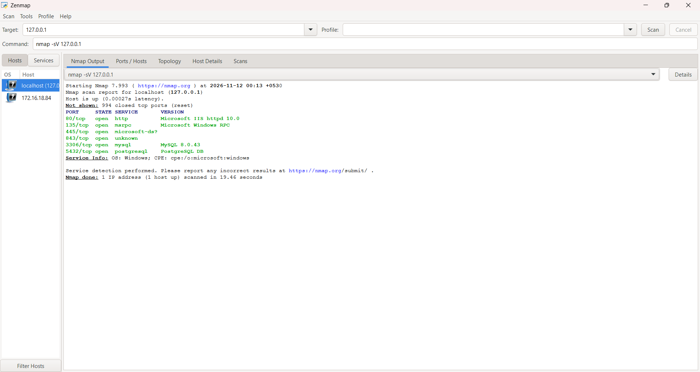
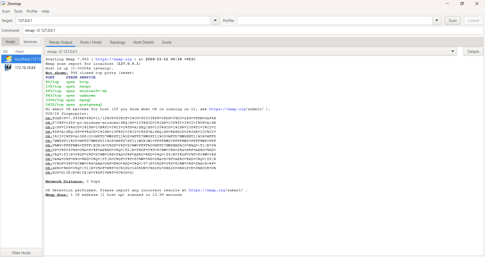

# 🌐 PM5 – Zenmap Network Scanning and Analysis

**Host Discovery • TCP Port Scanning • Service Detection • OS Detection**

## 🔹 Overview

This project focuses on practical network scanning and analysis using **Nmap and Zenmap** on a Windows system.

The exercises explore host discovery, TCP port scanning, service version detection, operating system detection, and scan result analysis.

The practical scans were performed against the local machine using the loopback address `127.0.0.1` in a controlled environment.

## 🔹 Objectives

- Understand network scanning fundamentals.
- Explore the Zenmap graphical interface.
- Identify whether a host is reachable.
- Examine TCP port states.
- Perform service version detection.
- Explore operating system fingerprinting.
- Identify local network configuration and MAC address.
- Save and analyze Nmap scan results.
- Visualize the scan topology.

## 🔹 Tools and Technologies

| Tool | Purpose |
|---|---|
| Windows | Practical testing environment |
| Nmap 7.99 | Network scanning and analysis |
| Zenmap 7.99 | Graphical interface for Nmap |
| Command Prompt | Network configuration and MAC address identification |

**Scan Target:** `127.0.0.1` (Localhost)

## 🔹 Practical Exercises

### 01. Zenmap Installation and Interface Exploration

**Objective:** Install Zenmap and explore its graphical interface and scanning profiles.

**Key Activities:**
- Installed and opened Zenmap on Windows.
- Explored the target field and scan profile selection.
- Examined the scan command and output sections.
- Explored available scanning profiles.

**Screenshot:**



### 02. Windows IP Configuration

**Objective:** Identify the system's network configuration.

**Key Activities:**
- Used `ipconfig` to examine network interfaces.
- Identified the active Wi-Fi IPv4 address.
- Examined the subnet mask and default gateway.
- Identified the VirtualBox Host-Only network adapter.

**Screenshot:**



### 03. Ping Scan – Host Discovery

**Objective:** Check whether the local host is active and reachable.

**Command:**

```bash
nmap -sn 127.0.0.1
```

**Observation:**

The scan successfully identified the local machine as up.

**Screenshot:**



### 04. MAC Address Identification

**Objective:** Identify the MAC addresses of the system's network adapters.

**Command:**

```cmd
getmac /v
```

**Key Activities:**
- Examined the available network adapters.
- Identified the physical address associated with the active Wi-Fi adapter.
- Observed the VirtualBox Host-Only adapter's MAC address.

**Screenshot:**



*Note: These are the local system's adapter addresses, not MAC addresses discovered from other LAN hosts.*

### 05. Service Version Detection

**Objective:** Identify services and their version information on open TCP ports.

**Command:**

```bash
nmap -sV 127.0.0.1
```

**Observation:**

The scan identified the following open TCP ports and services:

| Port | Service | Detected Version |
|---|---|---|
| 80/tcp | HTTP | Microsoft IIS httpd 10.0 |
| 135/tcp | MSRPC | Microsoft Windows RPC |
| 445/tcp | Microsoft-DS | Version not identified |
| 843/tcp | Unknown | Version not identified |
| 3306/tcp | MySQL | MySQL 8.0.43 |
| 5432/tcp | PostgreSQL | PostgreSQL DB |

The scan also reported 994 closed TCP ports.

**Screenshot:**



### 06. Operating System Detection

**Objective:** Explore operating system fingerprinting using Nmap.

**Command:**

```bash
nmap -O 127.0.0.1
```

**Key Activities:**
- Used the `-O` option to enable OS detection.
- Examined the host status and port information.
- Explored Nmap's operating system fingerprinting capability.

**Note:** OS detection on a localhost target may be limited and should not be treated as a definitive operating system fingerprint.

**Screenshot:**



### 07. Saving Nmap Scan Results

**Objective:** Save scan output for documentation and further analysis.

**Command:**

```bash
nmap -sV -oN zenmap_local_scan.txt 127.0.0.1
```

**Key Activities:**
- Used the `-oN` option to save output in normal text format.
- Stored the scan results in a text file.
- Preserved the output for further reference.

**Output File:** [zenmap_local_scan.txt](zenmap_local_scan.txt)

### 08. Network Topology Visualization

**Objective:** Explore the topology visualization available in Zenmap.

**Key Activities:**
- Opened the Topology tab in Zenmap.
- Examined the localhost scan visualization.
- Captured the topology and exported it as a PDF.

**Output File:** [Network_Topology.pdf](Network_Topology.pdf)

**Screenshot / Output:**


## 🔹 Scope and Limitations

The practical scanning was restricted to the local machine (`127.0.0.1`).

Although the active Wi-Fi network configuration was examined, LAN-wide host discovery was not performed because authorization to scan other devices on the college network was not available.

Therefore, the localhost scan results do not represent the total number of live devices or MAC addresses on the college network.

## 🔹 Key Learning Outcomes

- Understanding network scanning and host discovery.
- Exploring Nmap and Zenmap.
- Identifying TCP port states and services.
- Understanding service version detection.
- Exploring operating system fingerprinting.
- Examining local IP and MAC address information.
- Saving and reviewing scan outputs.
- Understanding the limitations of localhost scanning.

## 🔹 Cybersecurity Relevance

Network scanning is an important activity in network security assessment and vulnerability management.

Security professionals use tools such as Nmap to identify active hosts, examine exposed ports, detect running services, and understand the network attack surface.

This practical provided foundational experience with Nmap and Zenmap in a controlled local environment.

## 🔹 Official Resources

- [Nmap Official Website](https://nmap.org/)
- [Nmap Reference Guide](https://nmap.org/book/man.html)
- [Zenmap Documentation](https://nmap.org/zenmap/)
- [Microsoft Windows](https://www.microsoft.com/windows)

## 🔹 Author

**Harini Madasu**

B.Tech Mathematics and Computing Student

[LinkedIn Profile](YOUR_LINKEDIN_PROFILE_URL)

Continuously learning and building practical skills in cybersecurity, network scanning, and security analysis.
