#  🛡️ PENETRATION TESTING REPORT

## FOOTPRINTING & NETWORK SCANNING PHASES

### W2-PM-FINAL | CYBERSECURITY | NETWORKWALKS

| **Report Details** | **Information** |
|---|---|
| **Pentester Name** | Harini Madasu |
| **Program / Batch** | B084 – Network Walks |
| **Date** | 12 November 2026 |
| **Modules Completed** | W2-PM1 – Footprinting with Multiple Kali Tools |
| | W2-PM5 – Zenmap-based Network Scanning |
| **Client / Target** | 1. `example.com` (documentation domain) |
| | 2. Own controlled VirtualBox lab network (`10.0.0.0/24`) |
| **Permission Secured?** | Yes – activities were restricted to the documentation domain and the user's own controlled lab environment. |
| **Phases Covered** | Phase 1: Reconnaissance & Footprinting |
| | Phase 2: Scanning & Network Discovery |
| | Phase 3–5: Not covered in this report |

---

## 1. Liability Disclaimer

I have performed these activities for educational and practical learning purposes. The footprinting activity used `example.com`, a reserved documentation domain, while network scanning was restricted to my own controlled VirtualBox lab network.

No unauthorized scanning of college network devices or third-party systems was performed. The commands, screenshots, and observations in this report are included to demonstrate the practical exercises completed during the Network Walks cybersecurity training.

The instructor, authors, and Network Walks are not responsible for any misuse of the knowledge presented in this report. Every action performed using these techniques must be limited to systems for which proper authorization has been obtained.

## 2. Introduction

This report covers footprinting and information gathering using multiple Kali Linux tools (W2-PM1), along with network scanning using Zenmap and Nmap (W2-PM5).

The first module focuses on gathering domain information, identifying website technologies, examining DNS records, inspecting HTTP response headers, and detecting Web Application Firewall protection.

The second module focuses on understanding network scanning, identifying live hosts, recording IP and MAC address information, and generating a network topology using Zenmap.

Each activity includes the command used, the observation obtained, a screenshot as evidence, and its relevance to cybersecurity.

## 3. Tools Used

The following table lists the tools used in the practical activities and their respective purposes.

| **Tool** | **Purpose** |
|---|---|
| Kali Linux | Operating system used for footprinting and reconnaissance activities. |
| WHOIS | Retrieves domain registration information. |
| WhatWeb | Identifies website technologies and web server information. |
| Nslookup | Queries DNS records, including MX and NS records. |
| cURL | Retrieves HTTP response headers from a website. |
| Wafw00f | Detects Web Application Firewall protection. |
| DNSRecon | Performs DNS enumeration and information gathering. |
| Nmap | Discovers live hosts and performs network scanning. |
| Zenmap | Graphical interface for Nmap and network topology visualization. |
| Oracle VirtualBox | Provides a controlled virtual lab environment. |
| Windows CMD | Used for local network information and localhost scanning exercises. |

## 4. Activities Performed

### 4.1 Footprinting & Reconnaissance

The footprinting activity was performed on the documentation domain `example.com` using six different Kali Linux tools. The purpose was to understand how domain information, website technologies, DNS records, HTTP headers, and WAF protection can be identified.

**Step 1: WHOIS – Domain Information Gathering**

**Objective:** To retrieve domain registration information.

**Command:**

```bash
whois example.com
```

**Observation:** The WHOIS command executed successfully and displayed available domain registration and related information.

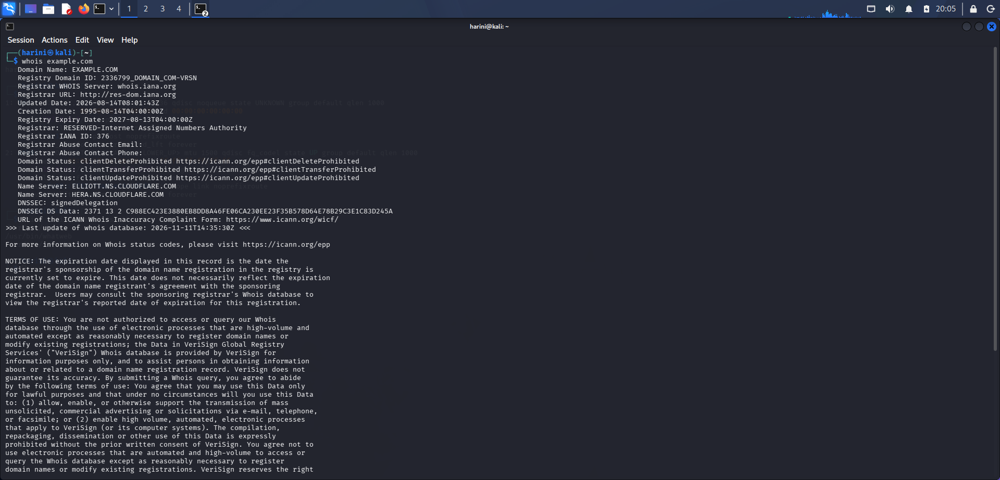

**Relevance:** WHOIS information can help security professionals understand domain registration details during the reconnaissance phase.

**Step 2: WhatWeb – Website Technology Identification**

**Objective:** To identify the technologies and web-related information associated with the target website.

**Command:**

```bash
whatweb http://example.com
```

**Observation:** WhatWeb version 0.6.4 was used to examine the website and identify available technology information.

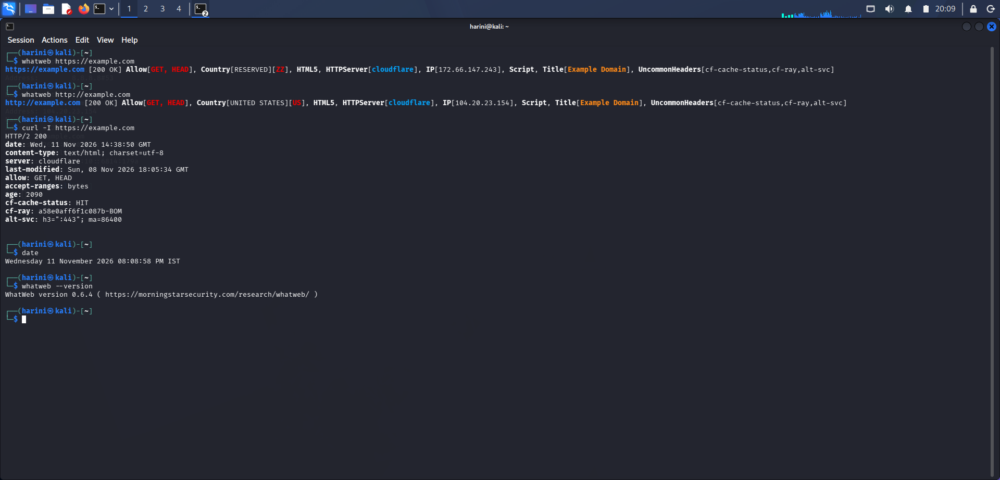

**Relevance:** Technology fingerprinting helps identify the web technologies used by a target and provides useful information during reconnaissance.

**Step 3: Nslookup – DNS Enumeration**

**Objective:** To retrieve DNS information for the target domain.

**Commands:**

```bash
nslookup example.com
nslookup -type=MX example.com
nslookup -type=NS example.com
```

**Observation:** The commands were used to query the domain's DNS resolution, mail exchange (MX), and name server (NS) records.

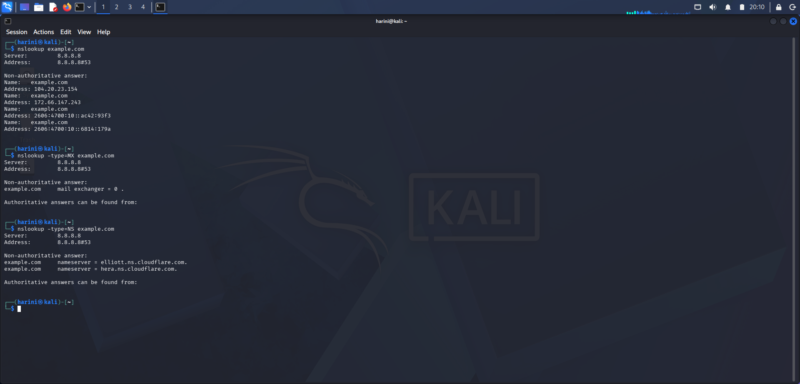

**Relevance:** DNS enumeration helps understand domain name resolution and identify DNS-related infrastructure information.

**Step 4: cURL – HTTP Response Header Inspection**

**Objective:** To inspect the HTTP response headers returned by the target website.

**Command:**

```bash
curl -I https://example.com
```

**Observation:** The command successfully retrieved the HTTP response headers using a HEAD request.

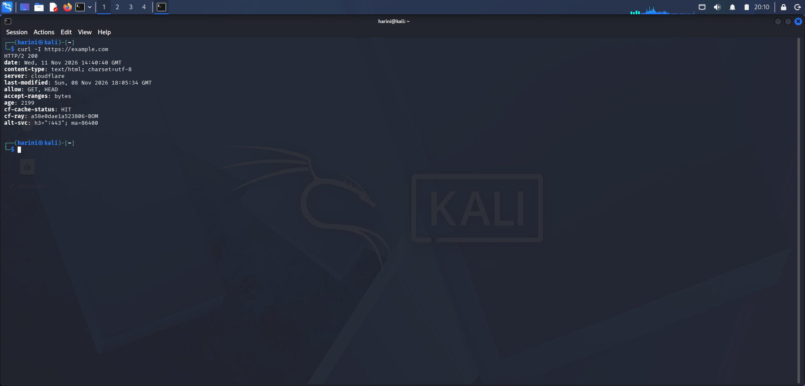

**Relevance:** HTTP response headers can reveal useful information about server responses and web application configuration.

**Step 5: Wafw00f – Web Application Firewall Detection**

**Objective:** To identify whether a Web Application Firewall protects the target website.

**Command:**

```bash
wafw00f https://example.com
```

**Observation:** Wafw00f version 2.4.2 identified Cloudflare as the WAF protecting the target domain.

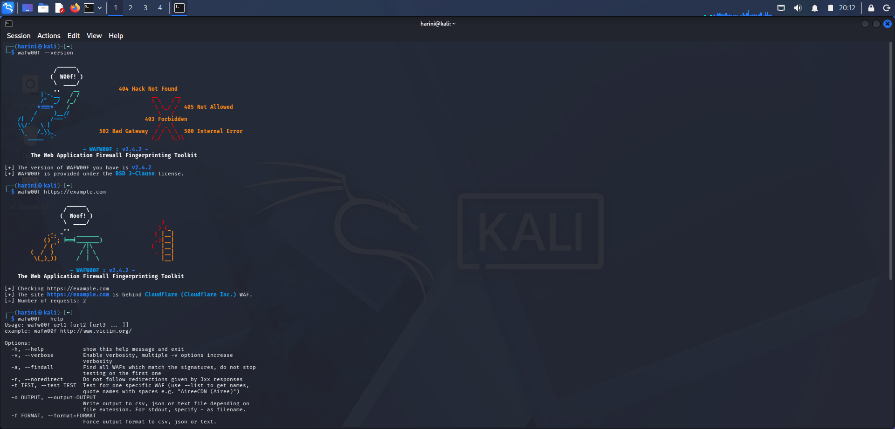

**Relevance:** WAF detection helps understand the security mechanisms used to protect web applications from common web-based attacks.

**Step 6: DNSRecon – DNS Information Gathering**

**Objective:** To perform standard DNS enumeration for the target domain.

**Command:**

```bash
dnsrecon -d example.com -t std
```

**Observation:** DNSRecon version 1.3.1 was used to perform standard DNS information gathering.

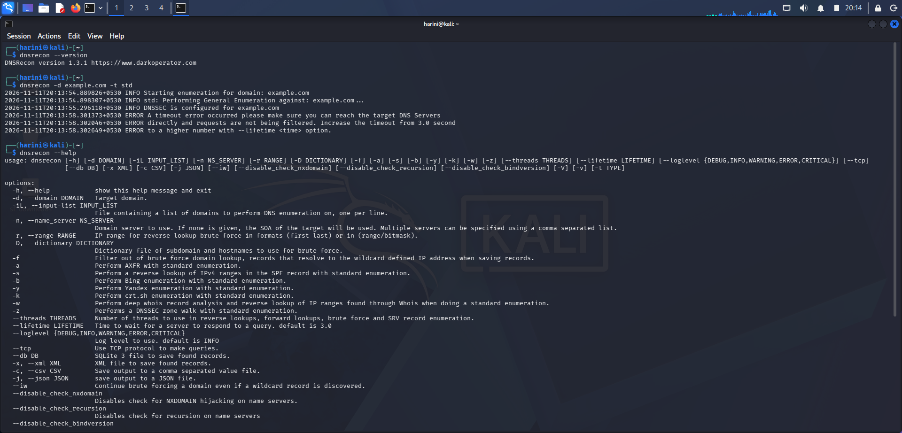

**Relevance:** DNSRecon helps security professionals collect DNS-related information that can be useful during reconnaissance and security assessments.

### 4.2 Network Scanning with Zenmap

The network scanning activity was performed using Nmap and Zenmap. Initial scanning exercises were carried out on the local Windows machine. Further host discovery and topology generation were performed within the controlled VirtualBox NAT Network (`10.0.0.0/24`).

**Step 1: Zenmap Interface**

**Objective:** To explore the Zenmap graphical interface and understand how it can be used to perform Nmap scans.

**Activity:** Zenmap was opened and its interface, target field, profile selection, and scan controls were explored.

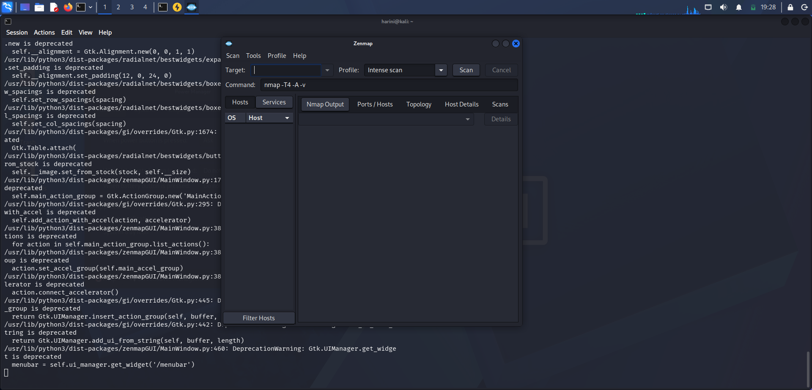

**Relevance:** Zenmap provides a graphical way to configure scans, view results, and visualize discovered network hosts.

**Step 2: Ping Scan**

**Objective:** To understand host discovery using a ping scan.

**Command:**

```bash
nmap -sn 127.0.0.1
```

**Observation:** The scan was performed against the localhost address to understand host discovery on the local machine.

**Screenshot:**

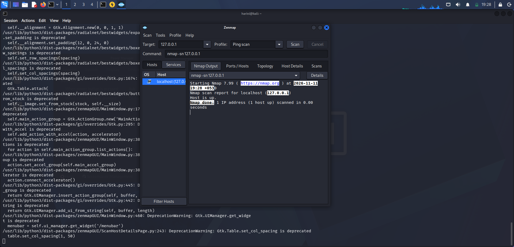

**Relevance:** Ping scanning helps determine whether a target host is reachable without performing a port scan.

**Step 3: Regular Scan**

**Objective:** To understand a basic Nmap scan and examine the information returned by it.

**Command:**

```bash
nmap 127.0.0.1
```

**Observation:** A regular scan was performed against the local machine to examine the scan results.

**Screenshot:**

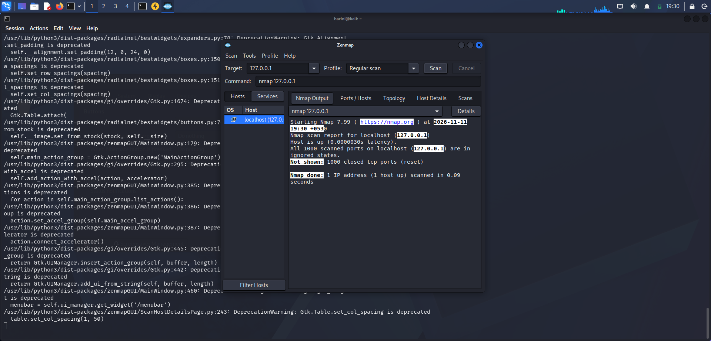

**Relevance:** A basic Nmap scan helps identify accessible ports on a target system.

**Step 4: Kali Linux IP Configuration**

**Objective:** To identify the IP address and network configuration of the Kali Linux virtual machine.

**Activity:** The network interface configuration was examined to identify the assigned IP address, subnet mask, and broadcast address.

**Observed Configuration:**

| **Parameter** | **Value** |
|---|---|
| Network Interface | `eth0` |
| Kali Linux IP | `10.0.0.2` |
| Subnet Mask | `255.255.255.0` |
| Network Address | `10.0.0.0/24` |
| Broadcast Address | `10.0.0.255` |

**Screenshot:**

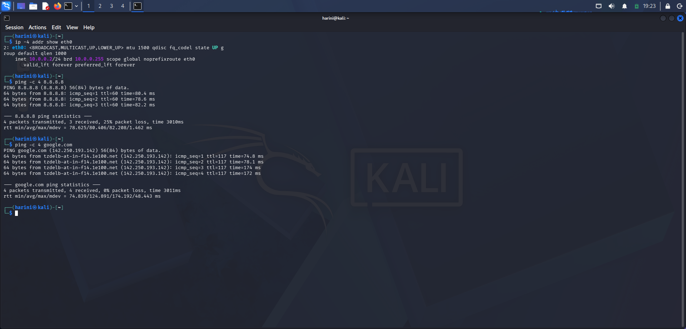

**Relevance:** Identifying the IP configuration is an important initial step before performing network discovery and scanning.

**Step 5: Live Host Discovery**

**Objective:** To identify active hosts within the controlled VirtualBox lab network.

**Command:**

```bash
sudo nmap -sn 10.0.0.0/24
```

**Observation:** The scan identified two live hosts within the lab subnet:

- `10.0.0.1`
- `10.0.0.2`

**Screenshot:**

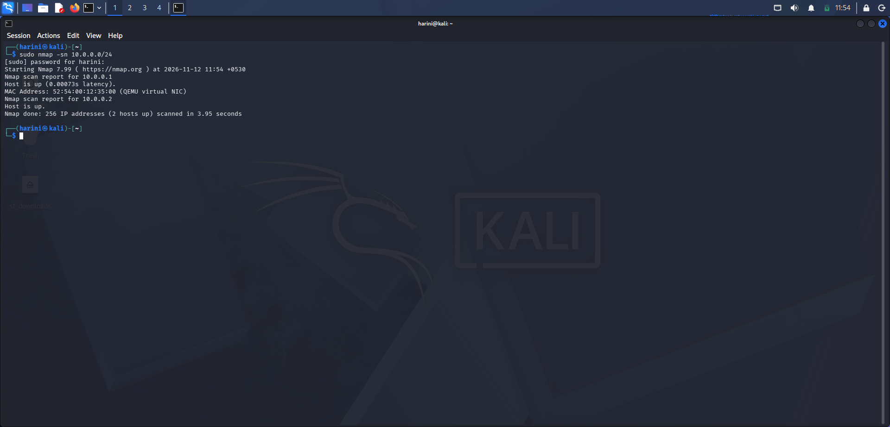

**Relevance:** Host discovery helps identify active devices within a network and provides an initial understanding of the network environment.

**Step 6: Live Host IP Address Identification**

**Objective:** To record the IP addresses of the active hosts discovered during the scan.

**Observation:** The Nmap results displayed two active IP addresses: `10.0.0.1` and `10.0.0.2`.

**Screenshot:**


**Relevance:** Recording IP addresses helps identify and document active devices within the authorized network.

**Step 7: Live Host MAC Address Identification**

**Objective:** To examine the MAC address information available for the discovered hosts.

**Command:**

```bash
sudo nmap -sn -PR 10.0.0.0/24
```

**Observation:** An ARP-based discovery scan was performed to retrieve available MAC address information from the controlled lab network.

**Screenshot:**

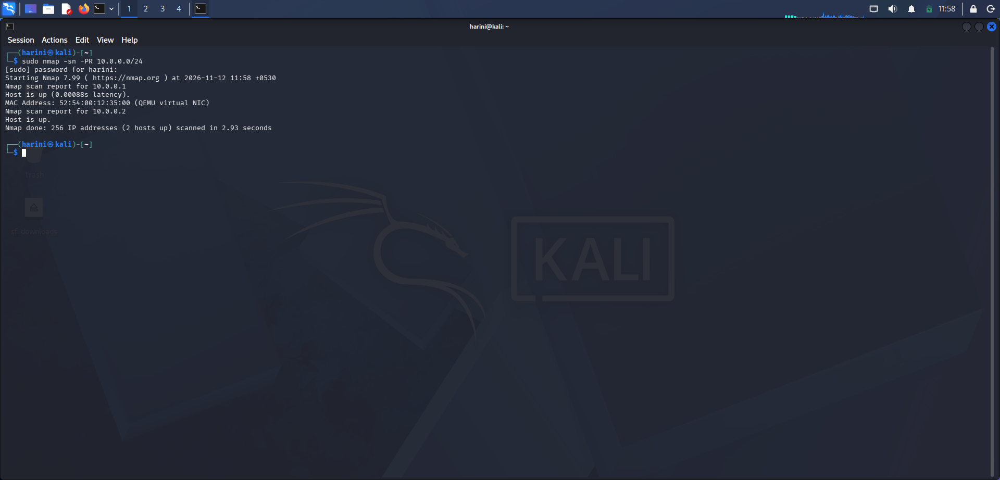

**Relevance:** MAC address identification helps associate discovered IP addresses with network interface hardware addresses within a local network.

**Step 8: Network Topology Generation**

**Objective:** To generate and save a visual representation of the discovered network hosts.

**Command:**

```bash
sudo nmap -sn -oX "$HOME/kali_lab_topology.xml" 10.0.0.0/24
```

**Activity:** The scan results were exported in XML format and opened in Zenmap. The topology view was used to visualize the discovered hosts, and the topology was saved in PDF and PNG formats.

**Generated Files:**

[kali_lab_topology.xml](PM5-Zenmap-Network-Scanning/kali_lab_topology.xml)

[Network topology.pdf](PM5-Zenmap-Network-Scanning/Network_Topology.pdf)

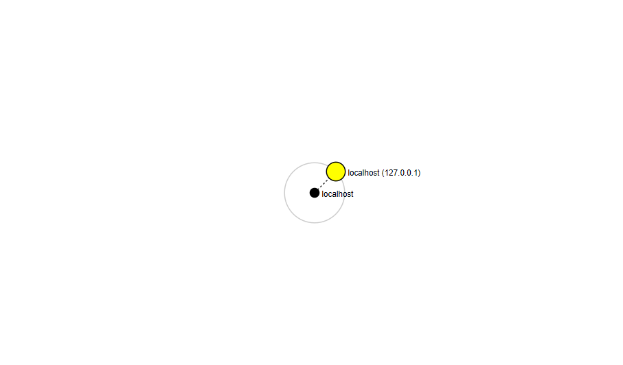


**Relevance:** Network topology visualization helps understand the structure of a network and provides a graphical representation of discovered hosts.

## 5. Risk Analysis / Impact

Based on the information collected during the footprinting and network scanning activities, the following potential risks and observations were identified.

| # | Risk / Finding | Evidence / Observation | Potential Impact | Risk Level |
|---|---|---|---|---|
| 1 | Domain information exposure | WHOIS information was retrieved. | Public registration information can support reconnaissance. | Informational |
| 2 | Website technology identification | WhatWeb was used to identify available technology information. | Technology information may assist further reconnaissance. | Informational |
| 3 | DNS information exposure | Nslookup and DNSRecon were used to examine DNS records. | DNS information may reveal infrastructure details. | Informational |
| 4 | HTTP response metadata | cURL retrieved HTTP response headers. | Response metadata may disclose details about the web environment. | Informational |
| 5 | WAF identification | Wafw00f identified Cloudflare protection. | Knowledge of defensive infrastructure may assist an attacker's reconnaissance. | Informational |
| 6 | Network host discovery | Nmap identified two live hosts in the controlled lab subnet. | Host discovery can help map the network environment. | Informational |

**Note:** These are observations from the practical exercises, not confirmed vulnerabilities. No exploitation or vulnerability validation was performed.

## 6. Recommendations

1. Regularly review publicly available domain registration information and avoid unnecessary exposure of sensitive administrative details.
2. Keep website technologies, frameworks, and server components updated.
3. Review DNS records periodically and remove outdated or unnecessary entries.
4. Configure appropriate HTTP security headers to improve web application security.
5. Maintain and properly configure Web Application Firewall protection.
6. Perform network scans only on systems and networks for which authorization has been obtained.
7. Maintain an updated inventory of active devices and their IP and MAC addresses.
8. Monitor network activity and investigate unexpected devices.
9. Conduct periodic security assessments to identify potential weaknesses and improve the overall security posture.

## 7. Conclusion

The Week 2 cybersecurity practical activities provided hands-on experience with footprinting, information gathering, DNS enumeration, WAF detection, and network scanning.

Through PM1, six Kali Linux tools were used to understand how domain-related information, website technologies, DNS records, HTTP headers, and WAF protection can be examined. Through PM5, Nmap and Zenmap were used to explore host discovery, IP and MAC address identification, and network topology visualization within a controlled VirtualBox lab environment.

These exercises strengthened practical knowledge of fundamental cybersecurity tools and demonstrated the importance of reconnaissance, network discovery, and authorized security testing.

## 8. Evidences Collected

The screenshots and output files collected during the practical activities are organized under their respective project folders.

**PM1 – Footprinting & Information Gathering**

1. WHOIS output – `WHOIS.png`
2. WhatWeb output – `WhatWeb.png`
3. Nslookup output – `NsLookup.png`
4. cURL output – `cURL.png`
5. Wafw00f output – `Wafw00f.png`
6. DNSRecon output – `DNSRecon.png`

[View PM1 Project and Screenshots](PM1-Footprinting-Information-Gathering/README.md)

**PM5 – Network Scanning with Zenmap**

1. Zenmap interface – `Zenmap_interface.png`
2. Ping scan – `Ping_Scan.png`
3. Regular scan – `Regular_Scan.png`
4. Kali IP configuration – `Kali_IP_Configuration.png`
5. Live host discovery – `Live_Host_Discovery.png`
6. Live host IP addresses – `Live_Host_IP_Addresses.png`
7. Live host MAC addresses – `Live_Host_MAC_Addresses.png`
8. Network topology – `Network_Topology.png`
9. Network topology PDF – `Network_Topology.pdf`
10. Nmap XML output – `kali_lab_topology.xml`

[View PM5 Project and Screenshots](PM5-Zenmap-Network-Scanning/README.md)

---

## 👤 Author

**Harini Madasu**  
B.Tech – Mathematics and Computing  
Central University of Karnataka  
Network Walks – Cybersecurity Training, Batch B084

## 📌 Project Information

**Project:** Week 2 – Cybersecurity Practical Activities  
**Organization:** Network Walks  
**Modules:** W2-PM1 and W2-PM5  
**Environment:** Kali Linux, Windows, Oracle VirtualBox  
**Tools:** WHOIS, WhatWeb, Nslookup, cURL, Wafw00f, DNSRecon, Nmap, and Zenmap

